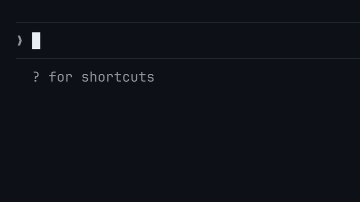

# Claude LaTeX Math

**简体中文** | [English](README.en.md)

Claude Code 插件：把 Claude 回复里的 LaTeX 公式在终端里渲染成图片，**公式里的中文也能渲染**。独立成行的公式渲染成一张图，行内公式渲染成嵌在文字行里的小图。



## 一键安装

```bash
git clone https://github.com/nocetfy/claude-latex-math-cjk.git
cd claude-latex-math-cjk
./install.sh
```

装完新开一个 Claude Code 会话（或执行 `/reload-plugins`）。也可以直接对 Claude Code 说：**"clone https://github.com/nocetfy/claude-latex-math-cjk 并按 README 安装"**。

`install.sh` 会做这些事，缺什么装什么，可以重复执行：

| 步骤 | macOS（Homebrew） | Debian / Ubuntu | Arch |
| --- | --- | --- | --- |
| LaTeX | `brew install --cask basictex` | `texlive-latex-recommended dvipng preview-latex-style` | `texlive-basic texlive-latex texlive-latexrecommended texlive-latexextra` |
| TeX 宏包 | `tlmgr install dvipng preview mathtools cjk arphic` | `latex-cjk-chinese` | `texlive-langchinese` |
| 中文字体 | Arphic `gbsn`（随 `arphic`） | `latex-cjk-chinese-arphic-gbsn00lp` | 随 `texlive-langchinese` |
| 图片处理 | `imagemagick` | `imagemagick` | `imagemagick` |

- fish 用户：`config.fish` 直接覆盖 PATH 导致找不到 TeX 时，追加一行把 `/Library/TeX/texbin` 加回去。
- 添加 marketplace `claude-latex-math-cjk`，安装插件 `latex-math`。已装了其他来源的 latex-math 插件的会先卸载它，因为两份会重复改写回复。
- 按终端设置图片模式：kitty、Ghostty 用 `images=auto`；Otty、WezTerm 用 `images=on`，并在 `~/.claude/settings.json` 的 `env` 里加 `CLAUDE_CODE_FORCE_TERMINAL_IMAGES=1`。可以用 `--images auto|on|off` 指定。
- 最后渲染一个含中文的公式，验证整条链路。

只检查不改动：`./install.sh --check`。其他选项：`./install.sh --help`。

已经装好 TeX 的，也可以只装插件：

```
/plugin install latex-math --marketplace nocetfy/claude-latex-math-cjk
```

装好后可以在 `/config` 里调插件选项，比如 `weight` 设成 `bold` 让公式用粗体，深色背景下更清楚，中文不受影响。完整选项见[设置](#设置)。

### 给 agent 的安装说明

1. clone 本仓库，在仓库根目录执行 `./install.sh`。
2. 退出码为 0 即成功；`Test render` 一行给出公式图片的路径，可以 Read 确认。
3. 退出码非 0 时看末尾 `Finished with N problem(s)` 下列出的问题：写着 `needs root; run this by hand` 的，把那条 `sudo ...` 命令交给用户，让用户在提示符里输入 `! sudo ...` 执行，然后再跑一次 `./install.sh`。macOS 上需要 root 时会弹出系统密码框，让用户在里面输入密码即可。
4. 最后告诉用户新开一个会话。

## 公式里的中文

公式里的中文和日文会被渲染，比如 `\text{补偿金额} \le x`。渲染器用的是 pdfTeX，它本身没有中日韩字体，不做这一步的话，这样的公式只会显示源码。

`bin/render.sh` 把每一段连续的汉字、平假名、片假名和全角字符，单独包进 `CJKutf8` 的 `CJK` 环境，用 Arphic 的 `gbsn` 字体排版。只包这些片段，是因为把整个公式包进去会画错字形（`\le` 会变成 "d"）。不含这些字符的公式完全不加载 CJK 宏包。这个字体只覆盖 GB2312，所以繁体字（補）和韩文仍然显示源码。

它额外需要 TeX Live 的 `cjk` 和 `arphic` 两个宏包，`install.sh` 会和其他依赖一起装好。

在 macOS 上，如果装了 `xelatex` 和 `pdftocairo`（poppler），含中文的公式改用 XeLaTeX 排版，中文用系统字体苹方（PingFang SC），繁体字也能显示。选项 `cjkFont` 可以换成别的系统字体（其他系统上设置它也会走这条路），设为 `none` 则始终用 `gbsn`。

终端的字符格子不是 1:2 时（比如 Noto Sans Mono 是 1:2.27），公式会被竖向拉伸。选项 `cellAspect` 可以修正；如果只想让汉字不变形、数学公式保持原样，就不改它，改设 `cjkStretch`（默认 1.135 配 1:2.27 的格子，1:2 的格子用 1）。`cjkScale` 调汉字大小，让它和终端正文的汉字一样大。这些选项都参与图片缓存的文件名，改了不用手动清缓存。

## 要求

- Claude Code 2.1.287 以上，这个版本起才能运行 mod。已用 2.1.289 测试。
- 支持 kitty 图形协议的终端：[kitty](https://sw.kovidgoyal.net/kitty/)、[Ghostty](https://ghostty.org)、Otty 或 WezTerm。Otty 和 WezTerm 需要把 `images` 设成 `on`，`install.sh` 会自动设置。其他终端里，公式显示为 Unicode 文本。
- TeX Live 的 `latex`、`dvipng` 和 `kpsewhich`，以及 LaTeX 宏包 `amsmath`、`amssymb`、`mathtools`、`bm` 和 `preview`。中文还需要 `CJKutf8` 和 Arphic 字体 `gbsn`（TeX Live 宏包 `cjk` 和 `arphic`）。
- ImageMagick 7（`magick`）或 ImageMagick 6（`convert` 和 `identify`）。
- `bash` 和 `awk`。

缺少某个工具或宏包时，插件会在会话开始时提示一次，然后把公式显示为 Unicode 文本。

手动安装可以用下面的命令：

| 系统 | 命令 | 测试情况 |
| --- | --- | --- |
| Arch Linux | `sudo pacman -S texlive-bin texlive-basic texlive-latex texlive-latexrecommended texlive-latexextra texlive-langchinese imagemagick` | 已测，Ghostty 1.3.1 |
| Debian、Ubuntu | `sudo apt install texlive-latex-recommended dvipng preview-latex-style latex-cjk-chinese latex-cjk-chinese-arphic-gbsn00lp imagemagick` | 渲染器已在 Ubuntu 24.04 上测试 |
| macOS | `brew install --cask basictex`，然后 `sudo tlmgr install dvipng preview mathtools cjk arphic` 和 `brew install imagemagick` | 已测，Otty 和 TeX Live 2026（BasicTeX） |

不支持 Windows，因为渲染器是 bash 脚本。

## 试一试

下面这些提问能看出插件的效果：

1. `解释 transformer 里的注意力机制，带上公式。` 回复里有缩放点积注意力的独立公式，正文里有 `$d_k$` 这样的行内符号。
2. `一步步推导矩阵形式的最小二乘估计。` 回复里有一串独立公式；如果 Claude 用了 `align` 环境，也会被渲染。
3. `写出微分形式的麦克斯韦方程组，并解释每一项。` 回复里有四个独立公式，解释里有行内的向量算子。

## 设置

在 `/config` 里修改选项，每个选项是插件名下的一行。在 shell 里，`claude plugin configure latex-math@claude-latex-math-cjk` 列出所有选项，`echo '{"images":"off"}' | claude plugin configure latex-math@claude-latex-math-cjk --values-stdin` 设置其中一个。

| 选项 | 取值 | 默认值 | 作用 |
| --- | --- | --- | --- |
| `images` | `auto`、`on`、`off` | `auto` | `auto` 在 kitty 和 Ghostty 里画图片，在其他终端里写 Unicode 文本。`on` 在插件认不出的终端里也画图片，比如通过 SSH 使用、`TERM` 被改成别的值的 kitty。`off` 始终写 Unicode 文本。 |
| `inline` | `image`、`unicode` | `image` | 开启图片时，行内公式怎么画。 |
| `promptSection` | `true`、`false` | `true` | 是否在系统提示词里告诉 Claude 公式会被渲染。 |
| `scale` | 0.5 到 2 | 1 | 独立公式的大小，是默认大小的倍数。 |
| `weight` | `normal`、`bold` | `normal` | `bold` 让所有公式用粗体数学字体，笔画更粗，深色背景下更清楚。 |
| `cellAspect` | 1 到 3 | 2 | 终端字符格子的高除以宽。和实际不符时图片会被拉伸或压扁。 |
| `cjkFont` | `auto`、`none` 或系统字体名 | `auto` | 公式里中文的字体。`auto` 在 macOS 上是苹方，其他系统上是 `gbsn`；`none` 始终是 `gbsn`。系统字体需要 `xelatex` 和 `pdftocairo`。 |
| `cjkStretch` | 0.5 到 2 | 1.135 | 系统字体的汉字横向加宽的倍数，抵消终端把图片竖向拉长。默认值配 1:2.27 的格子（如 Noto Sans Mono），1:2 的格子用 1。 |
| `cjkScale` | 0.5 到 2 | 0.8 | 系统字体的汉字大小，用来和终端正文的汉字对齐。 |
| `cacheSizeMB` | 1 到 10000 | 100 | 图片缓存的上限，单位 MB。 |

## 显示效果

- **独立公式。** `$$ ... $$`、`\[ ... \]`，以及 amsmath 环境 `equation`、`align`、`gather`、`multline`、`alignat`、`flalign` 和 `eqnarray`，在回复里原位变成一张图，公式要多少行就占多少行。
- **行内公式。** 段落或列表项里的 `$ ... $` 和 `\( ... \)` 变成一行文字高的图，和文字对齐在同一条基线上。比一行高的公式会被缩小以放进这一行。
- **其他块里的行内公式。** 在表格、标题或引用里，行内公式写成 Unicode 文本。比如 `$\beta_0 \leq x^2$` 变成 `β₀ ≤ x²`。
- **颜色。** 每个公式用 Claude Code 主题的文字颜色。自定义主题从主题文件里读 `text`；内置主题用终端的前景色。
- **不渲染的公式。** LaTeX 报错的公式，或者含有[数学命令列表](#公式是不可信的输入)之外命令的公式，显示源码。独立公式还会在源码下面写出原因。
- **保持为文字的内容。** `$5 and $10` 这样的价格、行内代码和代码块都不算公式。

插件把公式写成文字时，行内和独立公式都变成 Unicode。Unicode 表达不了的独立公式（比如矩阵）变成 LaTeX 代码块。一条回复需要渲染超过 60 个不同公式时，整条回复都写成文字，免得一段长推导启动 60 次 LaTeX。

## 插件告诉 Claude 什么

开启图片且 `promptSection` 为 `true` 时，插件在系统提示词里加这一节：

```text
# Math rendering
This terminal typesets LaTeX math as images. Display math (`$$ ... $$` on its own lines, or an amsmath environment such as `\begin{align} ... \end{align}`) is drawn in place at full size. Inline math (`$...$`) in a paragraph or a list item is drawn inside the line, one text row tall, so keep it to expressions that fit a line and put tall formulas (stacked fractions, matrices, sums with limits above and below) in display math. In a table, a heading or a quote, inline math is written as Unicode text instead. Use only the commands of LaTeX and amsmath, and define no macros: a formula with any other command is shown as source.
```

`inline` 设为 `unicode` 时，关于行内公式的两句换成这一句：

```text
Inline math (`$...$`) is written as Unicode text, so keep it to short expressions (symbols, subscripts, superscripts, simple fractions) and put larger formulas in display math.
```

插件把公式写成文字时、在 Claude Desktop 里、在 VS Code 的聊天面板里，都不往系统提示词里加任何内容。

## 工作原理

1. 终端里的会话开始时，插件决定一次要不要画图片。它像 Claude Code 一样从环境变量判断终端，并运行 `bin/render.sh --check` 找出缺少的工具。然后删掉最久没用的图片，直到缓存小于 `cacheSizeMB`。
2. 每条助手消息上的钩子把回复拆成文字、独立公式和行内公式。
3. 插件用数学命令列表检查每个公式，只有所有命令都在列表里，才交给渲染器。
4. `bin/render.sh` 对每个公式运行 `latex` 和 `dvipng`，把 PNG 补齐到整数个终端格子，写到 `~/.cache/claude-latex-math/`。文件名是公式、颜色、大小和粗细的哈希。
5. 钩子用 Claude Code 的 `Image` 元素画出每张 PNG。终端读取文件，通过 kitty 图形协议显示。通过 SSH 时终端读不到文件，插件改为直接发送 PNG 数据。
6. 含行内公式的段落按词逐个画在可换行的一行里，这样图片可以夹在两个词之间。

在开发机上，一个新公式大约要 0.2 秒，缓存过的公式大约 5 毫秒。

## 排障

**在 kitty 或 Ghostty 里公式显示为 Unicode 文本。** Claude Code 在 tmux、screen 里和后台会话里不画图片，所以插件在这些地方写 Unicode 文本。想让 Claude Code 强制画图片，在 `~/.claude/settings.json` 的 `env` 里设置 `CLAUDE_CODE_FORCE_TERMINAL_IMAGES=1`，然后新开会话。图片能不能显示出来取决于终端。插件没在 tmux 里测试过。有用户反馈，在 macOS 的 Ghostty 里，用这个变量加上 [cc-latex](https://github.com/chang-07/cc-latex) 的 `cc-tmux-bridge`，tmux 里也能显示图片。在 tmux 和 screen 之外，如果终端的 `TERM` 和 `TERM_PROGRAM` 被改过，插件也可能认不出来，这时把 `images` 设成 `on`。

**提示说某个工具没找到。** 按[要求](#要求)里的表格安装提示里列出的工具，然后新开会话。想自己查缺什么，可以运行检查命令，路径里换成你安装的版本：

```bash
bash ~/.claude/plugins/cache/claude-latex-math-cjk/latex-math/0.4.0-cjk.1/bin/render.sh --check
```

所有工具和宏包都齐全时，这个命令输出一个空行，退出码为 0。

**公式显示源码，下面有一行以 `not rendered:` 开头。** 这一行写了原因：要么 LaTeX 拒绝了这个公式，这一行里是 TeX 的报错；要么公式里有不在数学命令列表里的命令。让 Claude 用标准命令重写这个公式。如果列表里漏了某个标准数学命令，请提 issue。

**公式显示为暗色的 LaTeX 源码。** 插件选择了画图片，但终端画不出来。把 `images` 设成 `off`，改为显示 Unicode 文本。

**公式颜色不对。** 插件在画回复时读取颜色。换主题之后，新的回复会用新颜色。

**缓存占用磁盘太多。** 调低 `cacheSizeMB`，或者删除 `~/.cache/claude-latex-math`。插件需要时会重新渲染公式。

**关闭插件。** 在 `/plugin` 的 **Installed** 标签页里禁用 `latex-math`。

## 限制

- 含行内公式的段落里，链接会显示成 Markdown 源码 `[text](url)`。
- 行内公式的基线按常见等宽字体的度量计算，对应 `bin/render.sh` 里的 `BASELINE`。
- 换主题后，已经显示在屏幕上的公式保持原来的颜色，直到 Claude Code 重新画这条消息。
- Unicode 回退会保留含环境或未知命令的公式的 LaTeX 源码。
- `weight` 设为 `bold` 时，有些符号仍是正常粗细，因为 Computer Modern 字体没有它们的粗体版：独立公式里的积分号、求和号这类大运算符，大号括号，以及 `\mathbb{R}`、`\leqslant` 这类 amssymb 符号。`\bm{...}` 或 `\boldsymbol{...}` 里的符号看起来和外面一样。粗体公式也会宽十分之一左右。
- 插件只渲染 LaTeX、amsmath、amssymb、mathtools 和 bm 的数学命令。用 `\newcommand` 或 `\def` 定义宏的公式不会被渲染。
- 插件从环境变量判断终端。Claude Code 还会向终端查询版本，mod 做不到这一点。在 0.28 之前的 kitty 里，插件会选择画图片，而 Claude Code 会把每个公式显示为暗色的 LaTeX 源码。

## 隐私

插件只在你的机器上运行，不向任何地方发送数据。[PRIVACY.md](PRIVACY.md) 列出了它读什么、写什么，以及文件保留多久。

## 插件运行、读取和发送的内容

插件不发起任何网络请求，也不下载任何东西。这一节里的所有内容都只留在你的电脑上。

### 钩子改了什么

插件有三个钩子。

- **助手消息上的 `ui.render`。** 它改变含公式的回复在终端里的画法：每个公式变成图片或 Unicode 文本。它不改消息本身，对话记录和 Claude 看到的内容仍然是 LaTeX 源码。
- **`prompt.compose`。** 开启图片且 `promptSection` 为 `true` 时，它在系统提示词末尾加一节，内容见[插件告诉 Claude 什么](#插件告诉-claude-什么)。它不改动、不删除其他任何一节。
- **`session.start`。** 它不改会话里的任何东西。在终端会话里，它决定公式怎么画、提示缺少的工具，并清理图片缓存。

插件不改你的提问、工具调用、权限或设置。

### 运行的程序

插件用 `$.process.run` 启动四种命令。`<plugin>` 是插件目录。`<stem>` 是图片不带 `.png` 的文件名：公式、颜色、大小和粗细的哈希。

| 命令 | 时机 | 用途 |
| --- | --- | --- |
| `bash <plugin>/bin/render.sh <缓存目录> <stem> <颜色> <display 或 inline> <大小> <normal 或 bold>` | 每个新公式一次 | 排版公式。脚本在临时目录里运行 `latex`、`dvipng` 和 ImageMagick（`magick`，或 `convert` 和 `identify`），结束时删除这个目录。 |
| `bash <plugin>/bin/render.sh --check` | 终端会话开始时一次 | 列出缺少的工具和 LaTeX 宏包。脚本运行 `command -v` 和 `kpsewhich`。 |
| `rm -f -- <缓存文件>` | 终端会话开始时一次，缓存超过 `cacheSizeMB` 时 | 删除最久没用的图片。只删缓存目录里由渲染器命名的文件。 |
| `ghostty +show-config` | 在 Ghostty 里画回复时，最多每 5 秒一次 | 读取终端的前景色。 |

会变化的参数只有尖括号里的那些：一个目录路径、一个哈希、一个六位十六进制颜色、一个模式、一个数字，以及缓存目录里的文件路径。插件不会用公式或回复里的其他文字拼命令。公式只通过标准输入，作为 LaTeX 文档的正文交给渲染器。

渲染器是 shell 脚本，因为一个公式要在临时目录里用到 `latex`、`dvipng` 和 ImageMagick，而 mod API 没有删除文件的调用。`bin/render.sh` 里的每个命令名都是写死在脚本里的。

### 公式是不可信的输入

公式来自模型，而 LaTeX 是一门编程语言。插件从四个方面限制公式能做的事。

- **只允许数学命令。** 只有当公式里的每个命令都在 `hooks/commands.ts` 的列表里时，插件才把它交给 LaTeX。列表里有大约 760 个数学命令和 57 个环境，涵盖 LaTeX、amsmath、amssymb、mathtools 和 bm 的符号和结构命令，没有任何读文件、定义宏或改变 LaTeX 读取输入方式的命令。含其他命令的公式显示源码。
- **不运行程序。** `latex` 关闭 shell escape（`-no-shell-escape`），`dvipng` 关闭 Ghostscript（`--nogs`）。
- **不写工作目录以外的地方。** `latex` 以 `openout_any=p` 运行。列表里唯一会写文件的命令是 `\label`，它只往该目录里 LaTeX 自己的 `.aux` 文件加一行。
- **限制时间和大小。** `latex` 和 `dvipng` 20 秒后停止，任一方向超过 255 个终端格子的图片会被拒绝。

LaTeX 本身不限制公式能读哪些文件：TeX Live 2026 让 `openin_any` 设置失效了。阻止公式读文件靠的是命令列表。`tools/commands.py probe` 在已安装的 LaTeX 上测试这个列表：它在每个参数位置用一个诱饵命令名和一个诱饵文件调用每个列表里的命令，只要 LaTeX 运行了这个命令名、打开了这个文件，或者改变了输入规则没有恢复，测试就失败。CI 在每个 pull request 和每次推送到 `main` 时运行这个探测。

### 发送了什么，发到哪里

- 每个公式的 LaTeX 通过标准输入交给 `bin/render.sh`。
- 每张图片通过 Claude Code 的 `Image` 元素交给终端：本地是文件路径，SSH 下是 PNG 数据。
- 缺少工具时，用 `$.ui.log` 往对话记录里写一行提示。Claude 看不到这行。
- 系统提示词那一节随 Claude Code 自己发给 Anthropic 的请求一起发给 Claude。插件只是加上这一节，自己不发送任何东西。

### 读取了什么

- Claude 的回复，也就是 Claude Code 正在画的内容。
- 用 `$.fs.read` 读两类文件。从 `~/.claude/themes/` 里的自定义主题文件读 `text` 颜色，文件没设文字颜色时读基础主题名，用来决定渲染器的 `<颜色>` 参数。通过 SSH 时，读取渲染器写出的每个图片文件，把数据发给终端。没有其他文件内容会交给程序或离开插件。
- 用 `$.config.list` 读 `/config` 里的 `theme` 一行，不读其他设置。
- `ghostty +show-config` 的输出，从中取前景色。
- 环境变量 `HOME`、`XDG_CACHE_HOME` 和 `CLAUDE_CONFIG_DIR`，用来找目录。`TERM`、`TERM_PROGRAM`、`KITTY_WINDOW_ID`、`TMUX`、`STY`、`CLAUDE_CODE_SESSION_KIND` 和 `CLAUDE_CODE_FORCE_TERMINAL_IMAGES`，用来判断终端能不能画图片。`SSH_CONNECTION` 和 `SSH_TTY`，用来判断终端是不是在另一台电脑上。这些都不是凭据，插件也不把它们发到任何地方。
- 缓存目录的文件列表，以及某个图片文件是否还在。

插件不从环境变量或文件里读取任何令牌、API key 或密码。

图片写在 `~/.cache/claude-latex-math/`；设置了 `$XDG_CACHE_HOME` 时写在 `$XDG_CACHE_HOME/claude-latex-math/`。在仓库里运行 `claude plugin validate .` 可以看到插件挂的每个事件和发起的每个调用。

## 安全

报告漏洞请看 [SECURITY.md](SECURITY.md)。

## 反馈

在 [github.com/nocetfy/claude-latex-math-cjk/issues](https://github.com/nocetfy/claude-latex-math-cjk/issues) 提 issue。请写上你的终端、系统、`claude --version` 的输出，以及出问题的公式。

## 开发

```bash
git clone https://github.com/nocetfy/claude-latex-math-cjk
cd claude-latex-math-cjk

# 不安装，只在本次会话里加载插件
claude --plugin-dir .

# 检查插件并运行测试
claude plugin validate .
claude plugin test .

# 用真实公式测试渲染器
tests/render.test.sh

# 在你的 LaTeX 上探测数学命令列表
python3 tools/commands.py probe
```

CI 在每次推送和 pull request 时运行同样的命令，并用 `shellcheck` 检查 shell 脚本。

`tools/commands.py generate` 生成数学命令列表 `hooks/commands.ts`。要多允许一个命令，把它加进脚本里的列表，运行 `generate`，再运行 `probe`。

在 shell 里渲染一个公式：

```bash
printf '\\[ e^{i\\pi} + 1 = 0 \\]' | bin/render.sh /tmp/math euler d8d8d8 display
```

脚本输出占用的格子数，并写出 `/tmp/math/euler.png`。

渲染演示动图：先运行 `demo/make_demo.py`，再运行 `demo/encode.sh`，需要装了 Pillow 的 Python 和 ffmpeg。README 里的动图是 `demo/encode.sh` 生成的 720 px GIF，因为插件目录不接受超过 5 MiB 的文件。

`demo/make_icon.py` 用一个 LaTeX 排版的公式画出插件图标。

[CHANGELOG.md](CHANGELOG.md) 记录了每个版本的改动。

## 致谢

这个方法来自 Jarrod Watts 的 [claude-image-view](https://github.com/jarrodwatts/claude-image-view)，它用同样的 `Image` 元素显示粘贴的图片。

## 许可

MIT，见 [LICENSE](LICENSE)。
